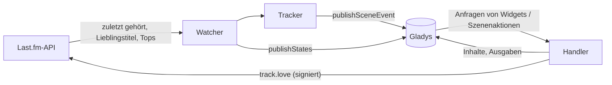
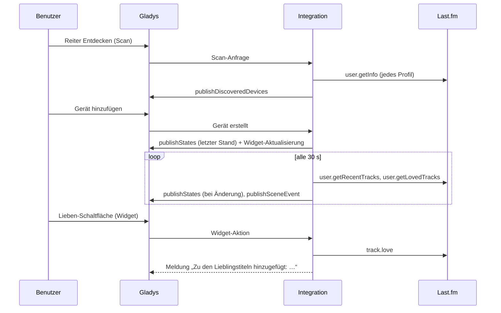
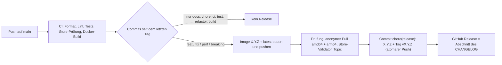

# Gladys Last.fm

[English](README.md) · [Français](README.fr.md) · **Deutsch** · [Español](README.es.md)

[](LICENSE)
[](https://github.com/William-De71/gladys-lastfm/releases)
[](https://github.com/William-De71/gladys-lastfm/actions/workflows/release.yml)
[](https://gladysassistant.com)


Externe [Gladys Assistant](https://gladysassistant.com)-Integration für **Last.fm**: was du gerade hörst, deine
Scrobbles, musikgesteuerte **Szenen** und **Dashboard-Widgets**, gebaut auf `@gladysassistant/integration-sdk` 0.15.

Last.fm zeichnet die Titel auf, die auf Spotify, Deezer, Apple Music, YouTube Music, Plex, Sonos und vielen
weiteren Playern laufen: Eine Integration deckt jeden Player ab, der scrobbelt.


Benutzerdokumentation: [English](docs/en.md) · [Français](docs/fr.md) · [Deutsch](docs/de.md) ·
[Español](docs/es.md).

> Community-Integration, nicht mit Last.fm verbunden.

## Inhalt

- [Funktionen](#funktionen)
- [Architektur](#architektur)
- [Installation](#installation)
- [Konfiguration](#konfiguration)
- [Funktionsweise](#funktionsweise)
- [Entwicklung](#entwicklung)
- [Release und Commit-Konvention](#release-und-commit-konvention)
- [Fehlerbehebung](#fehlerbehebung)
- [Mitwirken](#mitwirken)
- [Lizenz](#lizenz)

## Funktionen

### Geräte

Ein Gerät pro abonniertem Profil (höchstens 10), angeboten im Reiter Entdecken, alle Funktionen nur lesend:

| Funktion                       | Kategorie / Typ                                 | Hinweise                                                    |
| ------------------------------ | ----------------------------------------------- | ----------------------------------------------------------- |
| Hört gerade                    | `music` / `playback_state`                      | 1, solange ein Titel läuft                                  |
| Aktueller oder letzter Titel   | `text` / `text`                                 | „Künstler – Titel“, wird nie geleert                        |
| Scrobbles heute                | `counter-sensor` / `integer`                    | seit Mitternacht in der Zeitzone von Gladys (`TZ`)          |
| Scrobbles insgesamt            | `counter-sensor` / `integer`                    | ein unbekannter Zähler wird weggelassen, nie als 0 gesendet |
| Titel, Interpret, Album, Cover | `music` / `title`, `artist`, `album`, `artwork` | aktuelle Wiedergabe von Gladys 5.3, leer, wenn nichts läuft |

Die `music`-Funktionen (seit Gladys 5.3, `"music": {}`) laufen über `publishNowPlaying`, nur bei Änderungen; das Cover liefert das SDK hinter einem Schlüssel aus. Weder Dauer noch Position (Last.fm liefert beides nicht), und keine Musikbox im Dashboard: Ein Profil ist kein Player, der Wiedergabe / Pause gehorcht. Ein zuvor erstelltes Gerät erhält sie mit der Schaltfläche **Aktualisieren** im Reiter Entdecken.

Externe IDs: `ext:<selector>:user:<Benutzername in Kleinbuchstaben>[:<Funktion>]`.

### Szenenauslöser

| Auslöser            | Wird ausgelöst, wenn…                                                    | Filter                                 |
| ------------------- | ------------------------------------------------------------------------ | -------------------------------------- |
| `track_started`     | ein Titel läuft, der bei der vorigen Abfrage nicht lief                  | Profil (`source: "devices"`), Künstler |
| `listening_started` | etwas läuft, nachdem nichts lief                                         | Profil                                 |
| `listening_stopped` | zwei Abfragen in Folge nichts lief (Dauer der Sitzung, Anzahl der Titel) | Profil                                 |
| `track_loved`       | ein Titel oben in den Lieblingstiteln erscheint                          | Profil, Künstler                       |

Die erste Abfrage nach einem Start dient als Ausgangspunkt (eine laufende Sitzung wird nicht erneut gemeldet). Ein
`track_started` pro Titelwechsel: Derselbe Titel zweimal hintereinander ist ein Ereignis.

Beispiel: **Wiedergabe gestartet** (Profil „rj“) → Wohnzimmer dimmen und Verstärker einschalten; **Wiedergabe
beendet** → ausschalten und `{{triggerEvent.data.summary}}` senden („rj hat nach 42 Min. aufgehört zu hören (11
Titel).“).

### Szenenaktionen

`get_now_playing`, `get_stats` (heute / insgesamt, Top-Künstler, -Album und -Titel über einen Zeitraum),
`love_track` und `unlove_track` (verknüpftes Konto; leere Felder = aktueller oder letzter Titel).

Beispiel: jeden Abend um 22 Uhr → **Last.fm: Hörstatistiken** → eine Nachricht mit der Ausgabe `summary` senden.

### Dashboard-Widgets

| Widget          | Inhalt                                                                                               |
| --------------- | ---------------------------------------------------------------------------------------------------- |
| `now_playing`   | Cover, Titel, Künstler · Album, Kacheln heute / insgesamt, Status, Lieben-Schaltfläche, Last.fm-Link |
| `recent_tracks` | Kartenliste (1–8) mit Covern, Daten, Markierungen „Jetzt“ und „♥“                                    |
| `top_charts`    | Top-Künstler / -Alben (Cover-Raster, bis zu 12) / -Titel, von 7 Tagen bis zur gesamten Zeit          |

`now_playing` und `recent_tracks` werden bei jeder vom Watcher erkannten Änderung und beim Hinzufügen eines Geräts
aufgefrischt (`requestWidgetRefresh`).

Cover: Der Bildschlüssel des Widgets kodiert den Hash des Last.fm-Bildes (`lf-<hash>-<ext>`), der Handler baut die
URL `lastfm.freetls.fastly.net` nur aus geprüften Teilen wieder auf (kein SSRF, funktioniert nach einem Neustart),
prüft die Magic Numbers und die Grenze von 300 KB. Der graue Stern, den Last.fm seit 2019 für alle Künstler liefert,
gilt als „kein Bild“; GIF-Cover werden übersprungen (der Kern liefert sie nicht aus).

### Sprachen

Englisch, Französisch, Deutsch und Spanisch: Manifest, Meldungen, Widgets, Szenen-Zusammenfassungen und
Dokumentation. Gladys übergibt die Sprache nur an die Widgets; Gerätenamen und Szenentexte folgen der Einstellung
**Sprache der Texte** (`auto` = Sprache der letzten Widget-Anfrage).

## Architektur




Vom Reiter Entdecken bis zum Zustand, und die Lieben-Schaltfläche:



Die Integration arbeitet nur über die Cloud (`transports: ["cloud"]`): Sie spricht mit der Web-API von Last.fm und
mit nichts im lokalen Netzwerk.

## Installation

In Gladys: **Integrationen → Store → Last.fm → Installieren**. Folge dann der
[Benutzerdokumentation](docs/de.md): API-Schlüssel, Profile, Reiter Entdecken, optionale Kontoverknüpfung.

Docker-Image: `ghcr.io/william-de71/gladys-lastfm`, Multi-Arch (amd64/arm64), ohne Root-Rechte, schreibgeschütztes
Dateisystem, OCI-Labels und das Manifest im Label `io.gladysassistant.manifest`.

## Konfiguration

| Schlüssel       | Typ            | Hinweise                                                            |
| --------------- | -------------- | ------------------------------------------------------------------- |
| `api_key`       | `secret`       | Pflichtfeld, 32 Hexadezimalzeichen                                  |
| `shared_secret` | `secret`       | nur für signierte Aufrufe (Verknüpfung, lieben / nicht mehr lieben) |
| `usernames`     | `string`       | durch Kommas getrennt, nach den Regeln von Last.fm geprüft          |
| `poll_interval` | `number`       | 15–300 s, Standard 30                                               |
| `language`      | `select`       | `auto` (Standard), `en`, `fr`, `de`, `es`                           |
| `account`       | `account_link` | Desktop-Authentifizierung von Last.fm                               |

Interne Schlüssel (außerhalb des Schemas): `session_key`, `session_user`, `last_language`.

Aktionen des Manifests: `test_connection`, `unlink_account`.

### Kontoverknüpfung

Der Desktop-Ablauf von Last.fm läuft über das Feld `account_link` (ein Anbieter, der nie zurückleitet):
`auth.getToken` (signiert) → der Browser öffnet `https://www.last.fm/api/auth/?api_key=…&token=…` → die Integration
fragt `auth.getSession` alle 3 s ab (Fehler 14 bis zur Freigabe), höchstens 15 Minuten lang, speichert den
Sitzungsschlüssel (er läuft bis zum Widerruf nicht ab) und meldet ihn über `setConnectionStatus`. Eine widerrufene
Sitzung (Fehler 9) wird beim nächsten Versuch gelöscht.

## Funktionsweise

Last.fm hat keine Push-API. Ein Watcher liest jedes Profil der Reihe nach (standardmäßig alle 30 s):
`user.getRecentTracks` (Limit 10, erweitert — aktueller Titel, Lieblingstitel, Gesamtzahl),
`user.getRecentTracks` seit Mitternacht (Zähler des Tages) und `user.getLovedTracks` (Limit 5). Drei Aufrufe pro
Profil und Runde: 0,3 Anfragen/s für drei Profile, weit unter dem Limit von Last.fm. Widgets und Szenenaktionen
verwenden den letzten Stand, solange er jünger als 20 s ist. Die Geräte werden mit `should_poll: false`
veröffentlicht: Der Watcher ist der einzige Timer, und Zustände werden nur bei Änderungen gesendet.

Fehler: Last.fm antwortet `{ error, message }` mit 200 oder 4xx; die Codes 8, 11, 16, 29, ein 5xx und
Netzwerkfehler werden einmal wiederholt. Ein ungültiger oder gesperrter Schlüssel und eine falsche Signatur setzen
den Verbindungsstatus mit einer klaren Meldung auf getrennt; ein privates (17) oder unbekanntes (6) Profil wird in
den Widgets erklärt.

## Entwicklung

```bash
npm install
npm run format:check
npm run lint
npm test
npx github:GladysAssistant/integration-store . --skip-image-check
docker build -t gladys-lastfm .
```

Node 22 oder neuer. Die Tests (`node --test`) greifen nie aufs Netzwerk zu. Zusätzlich zu den Unit-Tests:

- `test/structure.test.js` vergleicht die externen IDs, die vom Reiter Entdecken verglichenen Felder und alle
  Schlüssel des Manifests mit `test/fixtures/discovery.baseline.json` (Version 1.0.0): Bestehende Benutzer müssen
  nie ein Gerät neu anlegen;
- `test/i18n.test.js` prüft die vier Sprachen (Manifest, Texte, Dokumentation, READMEs) und validiert die
  Widget-Inhalte in jeder;
- `test/release.test.js` deckt das Release-Skript ab (Version, Changelog, Versionsanhebung).

`gladys_version` ist `>=5.3.0` (Widgets, Szenenauslöser und -aktionen, `account_link`, `source: "devices"`; die Musikwiedergabe und die Katalog-Suchbegriffe von Gladys 5.3).

## Release und Commit-Konvention

Releases laufen automatisch. Jeder Push auf `main` startet den Release-Workflow:



- Commits und PR-Titel folgen [Conventional Commits](https://www.conventionalcommits.org/de/), auf Englisch, für
  die Benutzer geschrieben: Sie werden zu den Zeilen des Changelogs. `feat` → Minor, `fix` / `perf` → Patch, `!`
  oder `BREAKING CHANGE:` → Major.
- `CHANGELOG.md` wird beim Release erzeugt: nie von Hand bearbeiten.
- Das Image wird veröffentlicht und geprüft, **bevor** das Manifest auf `main` die neue Version ankündigt.
- Manueller Start (Actions → Release → Run workflow): `release-as` erzwingt eine Version, `dry-run` zeigt nur
  Version und Notizen.
- Ein geschütztes `main` würde den Release-Commit ablehnen: Erlaube GitHub Actions, die Regel zu umgehen, oder
  nutze das Token einer GitHub App.

## Fehlerbehebung

| Symptom                                     | Wahrscheinliche Ursache                                                            |
| ------------------------------------------- | ---------------------------------------------------------------------------------- |
| „Last.fm lehnt den API-Schlüssel ab“        | Schlüssel falsch kopiert, oder falsches gemeinsames Geheimnis beim Verknüpfen      |
| Ein Profil fehlt im Reiter Entdecken        | der Benutzername existiert nicht (siehe Protokolle der Integration)                |
| „verbirgt die zuletzt gehörten Titel“       | das Profil hat die entsprechende Datenschutzoption auf Last.fm aktiviert           |
| Beim Hören passiert nichts                  | der Player scrobbelt nicht: Prüfe, ob der Titel in deinem Last.fm-Profil erscheint |
| Gerätenamen oder Zusammenfassungen englisch | **Sprache der Texte** einstellen oder einmal ein Last.fm-Widget anzeigen           |

Ausführliche Protokolle: Umgebungsvariable `DEBUG=gladys-integration-sdk` am Container setzen.

## Mitwirken

Issues und Pull Requests sind willkommen: Fehlerberichte mit der Gladys-Version, der Version der Integration und
den Protokollen ([Issue-Vorlagen](.github/ISSUE_TEMPLATE)). Rückmeldungen auch im
[Thread des Gladys-Forums](https://community.gladysassistant.com/t/integration-externe-last-fm-vos-ecoutes-musicales-dans-gladys/11035)
(auf Französisch). Sicherheitsprobleme: siehe [SECURITY.md](SECURITY.md).

## Lizenz

[Apache-2.0](LICENSE) — siehe [NOTICE](NOTICE).
