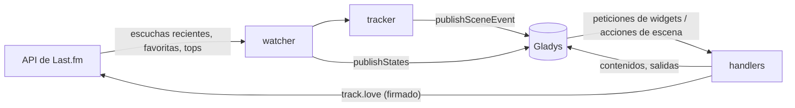
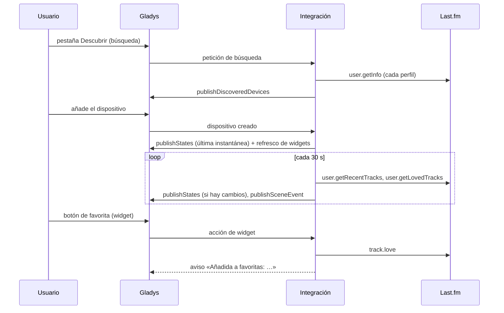
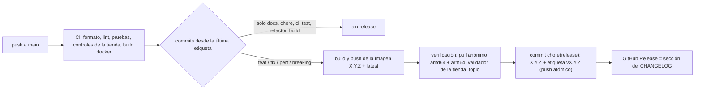

# Gladys Last.fm

[English](README.md) · [Français](README.fr.md) · [Deutsch](README.de.md) · **Español**

[](LICENSE)
[](https://github.com/William-De71/gladys-lastfm/releases)
[](https://github.com/William-De71/gladys-lastfm/actions/workflows/release.yml)
[](https://gladysassistant.com)


Integración externa de [Gladys Assistant](https://gladysassistant.com) para **Last.fm**: lo que estás escuchando,
tus scrobbles, **escenas** guiadas por la música y **widgets para el panel**, construida sobre
`@gladysassistant/integration-sdk` 0.15.

Last.fm registra las canciones reproducidas en Spotify, Deezer, Apple Music, YouTube Music, Plex, Sonos y muchos
más: una sola integración cubre todos los reproductores que hacen scrobble.


Documentación de usuario: [English](docs/en.md) · [Français](docs/fr.md) · [Deutsch](docs/de.md) ·
[Español](docs/es.md).

> Integración de la comunidad, sin relación con Last.fm.

## Índice

- [Funcionalidades](#funcionalidades)
- [Arquitectura](#arquitectura)
- [Instalación](#instalación)
- [Configuración](#configuración)
- [Funcionamiento](#funcionamiento)
- [Desarrollo](#desarrollo)
- [Release y convención de commits](#release-y-convención-de-commits)
- [Solución de problemas](#solución-de-problemas)
- [Contribuir](#contribuir)
- [Licencia](#licencia)

## Funcionalidades

### Dispositivos

Un dispositivo por perfil seguido (10 como máximo), propuesto en la pestaña Descubrir, todas las funcionalidades de
solo lectura:

| Funcionalidad                   | Categoría / tipo                                | Notas                                                           |
| ------------------------------- | ----------------------------------------------- | --------------------------------------------------------------- |
| Escuchando                      | `music` / `playback_state`                      | 1 mientras suena una canción                                    |
| Canción actual o última         | `text` / `text`                                 | «Artista – Canción», nunca se vacía                             |
| Scrobbles de hoy                | `counter-sensor` / `integer`                    | desde medianoche, en la zona horaria de Gladys (`TZ`)           |
| Scrobbles en total              | `counter-sensor` / `integer`                    | un contador desconocido se omite, nunca se publica como 0       |
| Título, Artista, Álbum, Portada | `music` / `title`, `artist`, `album`, `artwork` | reproducción en curso de Gladys 5.3, vacía cuando no suena nada |

Las funcionalidades `music` (desde Gladys 5.3, `"music": {}`) pasan por `publishNowPlaying`, solo cuando cambian; el SDK sirve la portada detrás de una clave. Ni duración ni posición (Last.fm no las da), y ninguna caja de música en el panel: un perfil no es un reproductor que obedezca a reproducir / pausa. Un dispositivo creado antes las obtiene con el botón **Actualizar** de la pestaña Descubrir.

Identificadores externos: `ext:<selector>:user:<nombre de usuario en minúsculas>[:<funcionalidad>]`.

### Disparadores de escena

| Disparador          | Se activa cuando…                                                          | Filtros                               |
| ------------------- | -------------------------------------------------------------------------- | ------------------------------------- |
| `track_started`     | suena una canción que no sonaba en la lectura anterior                     | perfil (`source: "devices"`), artista |
| `listening_started` | algo suena después de nada                                                 | perfil                                |
| `listening_stopped` | no ha sonado nada en dos lecturas seguidas (duración, número de canciones) | perfil                                |
| `track_loved`       | una canción aparece en cabeza de las favoritas                             | perfil, artista                       |

La primera lectura tras un arranque sirve de referencia (una escucha en curso no se vuelve a anunciar). Un solo
`track_started` por cambio de canción: la misma canción dos veces seguidas es un único evento.

Ejemplo: **Inicio de escucha** (perfil «rj») → atenuar el salón y encender el amplificador; **Fin de escucha** →
apagarlo y enviar `{{triggerEvent.data.summary}}` («rj ha dejado de escuchar tras 42 min (11 canciones).»).

### Acciones de escena

`get_now_playing`, `get_stats` (hoy / total, artista, álbum y canción favoritos en un periodo), `love_track` y
`unlove_track` (cuenta vinculada; campos vacíos = la canción actual o la última).

Ejemplo: cada noche a las 22:00 → **Last.fm: estadísticas de escucha** → enviar un mensaje con su salida `summary`.

### Widgets del panel

| Widget          | Contenido                                                                                            |
| --------------- | ---------------------------------------------------------------------------------------------------- |
| `now_playing`   | portada, canción, artista · álbum, mosaicos hoy / total, estado, botón de favorita, enlace a Last.fm |
| `recent_tracks` | lista de tarjetas (1–8) con portadas, fechas, insignias «Ahora» y «♥»                                |
| `top_charts`    | top de artistas / álbumes (cuadrícula de portadas, hasta 12) / canciones, de 7 días a desde siempre  |

`now_playing` y `recent_tracks` se refrescan (`requestWidgetRefresh`) con cada cambio que detecta el watcher y al
añadir un dispositivo.

Portadas: la clave de imagen del widget codifica el hash de la imagen de Last.fm (`lf-<hash>-<ext>`), el handler
reconstruye la URL `lastfm.freetls.fastly.net` solo a partir de piezas validadas (sin SSRF, funciona tras un
reinicio), comprueba los números mágicos y el límite de 300 KB. La estrella gris que Last.fm devuelve para todos los
artistas desde 2019 se trata como «sin imagen»; las portadas GIF se omiten (el núcleo no las sirve).

### Idiomas

Inglés, francés, alemán y español: manifiesto, mensajes, widgets, resúmenes de escena y documentación. Gladys solo
pasa el idioma a los widgets; los nombres de los dispositivos y los textos de las escenas siguen el ajuste **Idioma
de los textos** (`auto` = el idioma de la última petición de widget).

## Arquitectura




De la pestaña Descubrir a un estado, y el botón de favorita:



La integración funciona solo en la nube (`transports: ["cloud"]`): habla con la API web de Last.fm y con nada de la
red local.

## Instalación

Desde Gladys: **Integraciones → tienda → Last.fm → Instalar**. Después sigue la
[documentación de usuario](docs/es.md): clave de API, perfiles, pestaña Descubrir, vinculación de cuenta opcional.

Imagen Docker: `ghcr.io/william-de71/gladys-lastfm`, multiarquitectura (amd64/arm64), sin root, sistema de archivos
de solo lectura, etiquetas OCI y el manifiesto en la etiqueta `io.gladysassistant.manifest`.

## Configuración

| Clave           | Tipo           | Notas                                                      |
| --------------- | -------------- | ---------------------------------------------------------- |
| `api_key`       | `secret`       | obligatoria, 32 caracteres hexadecimales                   |
| `shared_secret` | `secret`       | solo para las llamadas firmadas (vinculación, favoritas)   |
| `usernames`     | `string`       | separados por comas, validados según las reglas de Last.fm |
| `poll_interval` | `number`       | 15–300 s, 30 por defecto                                   |
| `language`      | `select`       | `auto` (por defecto), `en`, `fr`, `de`, `es`               |
| `account`       | `account_link` | autenticación de escritorio de Last.fm                     |

Claves internas (fuera del esquema): `session_key`, `session_user`, `last_language`.

Acciones del manifiesto: `test_connection`, `unlink_account`.

### Vinculación de la cuenta

El flujo de escritorio de Last.fm pasa por el campo `account_link` (un proveedor que nunca redirige de vuelta):
`auth.getToken` (firmado) → el navegador abre `https://www.last.fm/api/auth/?api_key=…&token=…` → la integración
consulta `auth.getSession` cada 3 s (error 14 hasta la autorización) durante 15 minutos como máximo, guarda la
clave de sesión (no caduca hasta que se revoca) y lo comunica con `setConnectionStatus`. Una sesión revocada (error 9) se borra en el siguiente intento.

## Funcionamiento

Last.fm no tiene API push. Un watcher lee cada perfil por turnos (cada 30 s por defecto): `user.getRecentTracks`
(límite 10, extendido — canción actual, favoritas, total), `user.getRecentTracks` desde medianoche (contador del
día) y `user.getLovedTracks` (límite 5). Tres llamadas por perfil y ronda: 0,3 peticiones/s para tres perfiles, muy
por debajo del límite de Last.fm. Los widgets y las acciones de escena reutilizan la última instantánea mientras
tenga menos de 20 s. Los dispositivos se publican con `should_poll: false`: el watcher es el único temporizador, y
los estados solo se publican cuando cambian.

Errores: Last.fm responde `{ error, message }` con un 200 o un 4xx; los códigos 8, 11, 16, 29, un 5xx y los errores
de red se reintentan una vez. Una clave no válida o suspendida y una firma incorrecta ponen el estado de conexión en
desconectado con un mensaje claro; un perfil privado (17) o desconocido (6) se explica en los widgets.

## Desarrollo

```bash
npm install
npm run format:check
npm run lint
npm test
npx github:GladysAssistant/integration-store . --skip-image-check
docker build -t gladys-lastfm .
```

Node 22 o posterior. Las pruebas (`node --test`) nunca acceden a la red. Además de las pruebas unitarias:

- `test/structure.test.js` compara los identificadores externos, los campos que compara la pestaña Descubrir y
  todas las claves del manifiesto con `test/fixtures/discovery.baseline.json` (versión 1.0.0): los usuarios
  actuales nunca tienen que volver a crear un dispositivo;
- `test/i18n.test.js` comprueba los cuatro idiomas (manifiesto, textos, documentación, READMEs) y valida los
  contenidos de widget en cada uno;
- `test/release.test.js` cubre el script de release (versión, changelog, cambio de versión).

`gladys_version` es `>=5.3.0` (widgets, disparadores y acciones de escena, `account_link`, `source: "devices"`; la reproducción musical en curso y las palabras clave del catálogo de Gladys 5.3).

## Release y convención de commits

Las releases son automáticas. Cada push a `main` lanza el workflow Release:



- Los commits y títulos de PR siguen [Conventional Commits](https://www.conventionalcommits.org/es/), en inglés,
  escritos para el usuario: se convierten en las líneas del changelog. `feat` → minor, `fix` / `perf` → patch, `!`
  o `BREAKING CHANGE:` → major.
- `CHANGELOG.md` se genera en cada release: nunca lo edites a mano.
- La imagen se publica y se comprueba **antes** de que el manifiesto en `main` anuncie la nueva versión.
- Ejecución manual (Actions → Release → Run workflow): `release-as` fuerza una versión, `dry-run` solo muestra la
  versión y las notas.
- Una rama `main` protegida rechazaría el commit de release: permite que GitHub Actions omita la regla, o usa el
  token de una GitHub App.

## Solución de problemas

| Síntoma                                       | Causa probable                                                                 |
| --------------------------------------------- | ------------------------------------------------------------------------------ |
| «Last.fm rechaza la clave de API»             | clave mal copiada, o secreto compartido erróneo al vincular                    |
| Falta un perfil en Descubrir                  | el nombre de usuario no existe (consulta los registros de la integración)      |
| «oculta sus escuchas recientes»               | el perfil activó la opción de privacidad correspondiente en Last.fm            |
| No pasa nada al escuchar                      | el reproductor no hace scrobble: comprueba que la canción aparece en tu perfil |
| Nombres de dispositivos o resúmenes en inglés | ajusta **Idioma de los textos**, o muestra una vez un widget de Last.fm        |

Registros detallados: variable de entorno `DEBUG=gladys-integration-sdk` en el contenedor.

## Contribuir

Issues y pull requests bienvenidos: informes de error con la versión de Gladys, la de la integración y los registros
([plantillas de issue](.github/ISSUE_TEMPLATE)). Comentarios también en el
[hilo del foro de Gladys](https://community.gladysassistant.com/t/integration-externe-last-fm-vos-ecoutes-musicales-dans-gladys/11035)
(en francés). Problemas de seguridad: ver [SECURITY.md](SECURITY.md).

## Licencia

[Apache-2.0](LICENSE) — ver [NOTICE](NOTICE).
