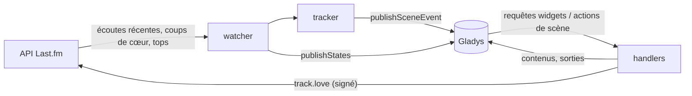
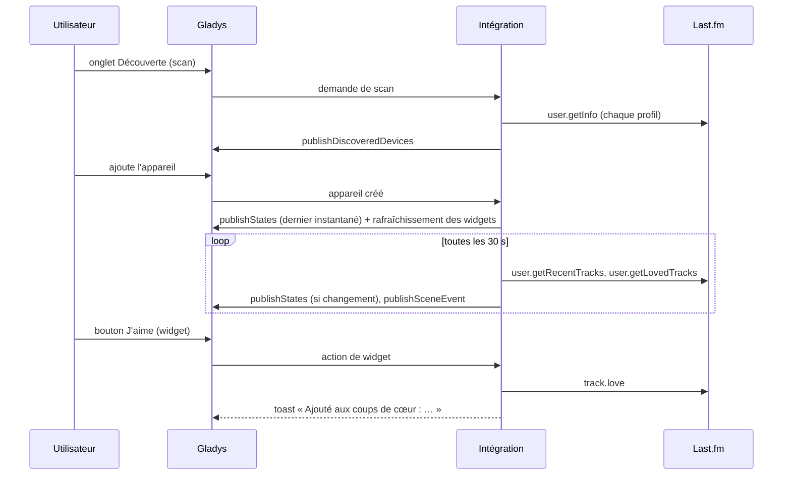
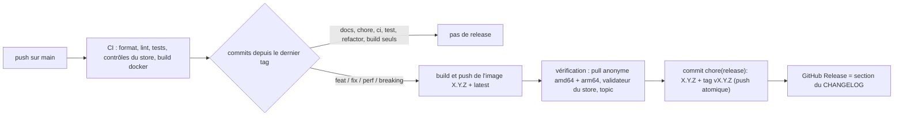

# Gladys Last.fm

[English](README.md) · **Français** · [Deutsch](README.de.md) · [Español](README.es.md)

[](LICENSE)
[](https://github.com/William-De71/gladys-lastfm/releases)
[](https://github.com/William-De71/gladys-lastfm/actions/workflows/release.yml)
[](https://gladysassistant.com)

Intégration externe [Gladys Assistant](https://gladysassistant.com) pour **Last.fm** : ce que vous écoutez, vos
scrobbles, des **scènes** pilotées par la musique et des **widgets de tableau de bord**, construite sur
`@gladysassistant/integration-sdk` 0.15.

Last.fm enregistre les titres écoutés sur Spotify, Deezer, Apple Music, YouTube Music, Plex, Sonos et bien
d'autres : une seule intégration couvre tous les lecteurs qui scrobblent.

Documentation utilisateur : [English](docs/en.md) · [Français](docs/fr.md) · [Deutsch](docs/de.md) ·
[Español](docs/es.md).

> Intégration communautaire, sans lien avec Last.fm.

## Sommaire

- [Fonctionnalités](#fonctionnalités)
- [Architecture](#architecture)
- [Installation](#installation)
- [Configuration](#configuration)
- [Fonctionnement](#fonctionnement)
- [Développement](#développement)
- [Release et convention de commits](#release-et-convention-de-commits)
- [Dépannage](#dépannage)
- [Contribuer](#contribuer)
- [Licence](#licence)

## Fonctionnalités

### Appareils

Un appareil par profil suivi (10 au maximum), proposé dans l'onglet Découverte, toutes les fonctionnalités en
lecture seule :

| Fonctionnalité                  | Catégorie / type             | Remarques                                              |
| ------------------------------- | ---------------------------- | ------------------------------------------------------ |
| En écoute                       | `music` / `playback_state`   | 1 pendant qu'un titre est joué                         |
| Titre en cours ou dernier titre | `text` / `text`              | « Artiste – Titre », jamais vidé                       |
| Scrobbles du jour               | `counter-sensor` / `integer` | depuis minuit, dans le fuseau horaire de Gladys (`TZ`) |
| Scrobbles au total              | `counter-sensor` / `integer` | un compteur inconnu est omis, jamais publié à 0        |

Identifiants externes : `ext:<selector>:user:<nom d'utilisateur en minuscules>[:<fonctionnalité>]`.

### Déclencheurs de scène

| Déclencheur         | Se déclenche quand…                                                    | Filtres                               |
| ------------------- | ---------------------------------------------------------------------- | ------------------------------------- |
| `track_started`     | un titre qui ne jouait pas à la lecture précédente joue                | profil (`source: "devices"`), artiste |
| `listening_started` | quelque chose joue après rien                                          | profil                                |
| `listening_stopped` | rien n'a joué pendant deux lectures de suite (durée, nombre de titres) | profil                                |
| `track_loved`       | un titre apparaît en tête des coups de cœur                            | profil, artiste                       |

La première lecture après un démarrage sert de référence (une écoute en cours n'est pas rejouée). Un seul
`track_started` par changement de titre : le même titre deux fois de suite fait un seul événement.

Exemple : **Début d'écoute** (profil « rj ») → tamiser le salon et allumer l'ampli ; **Fin d'écoute** → l'éteindre
et envoyer `{{triggerEvent.data.summary}}` (« rj a arrêté d'écouter après 42 min (11 titres). »).

### Actions de scène

`get_now_playing`, `get_stats` (jour / total, artiste, album et titre préférés sur une période), `love_track` et
`unlove_track` (compte lié ; champs vides = le titre en cours ou le dernier).

Exemple : chaque soir à 22 h → **Last.fm : statistiques d'écoute** → envoyer un message avec sa sortie `summary`.

### Widgets de tableau de bord

| Widget          | Contenu                                                                                           |
| --------------- | ------------------------------------------------------------------------------------------------- |
| `now_playing`   | pochette, titre, artiste · album, tuiles jour / total, état, bouton J'aime / Je n'aime plus, lien |
| `recent_tracks` | liste de cartes (1 à 8) avec pochettes, dates, badges « en cours » et « ♥ »                       |
| `top_charts`    | top artistes / albums (grille de pochettes, jusqu'à 12) / titres, de 7 jours à depuis toujours    |

`now_playing` et `recent_tracks` sont rafraîchis (`requestWidgetRefresh`) à chaque changement vu par le watcher,
et à l'ajout d'un appareil.

Pochettes : la clé d'image du widget encode le hash de l'image Last.fm (`lf-<hash>-<ext>`), le handler
reconstruit l'URL `lastfm.freetls.fastly.net` à partir de morceaux validés uniquement (pas de SSRF, fonctionne
après un redémarrage), contrôle les octets magiques et la limite de 300 Ko. L'étoile grise renvoyée par Last.fm
pour tous les artistes depuis 2019 est traitée comme « pas d'image » ; les pochettes GIF sont ignorées (le cœur ne
les sert pas).

### Langues

Anglais, français, allemand et espagnol : manifeste, messages, widgets, résumés de scène et documentation. Gladys
ne transmet la langue qu'aux widgets : les noms d'appareils et les textes des scènes suivent le réglage **Langue des
textes** (`auto` = la langue de la dernière requête de widget).

## Architecture




De l'onglet Découverte à un état, et le bouton J'aime :



L'intégration est uniquement cloud (`transports: ["cloud"]`) : elle parle à l'API web de Last.fm et à rien sur le
réseau local.

## Installation

Depuis Gladys : **Intégrations → store → Last.fm → Installer**. Suivez ensuite la
[documentation utilisateur](docs/fr.md) : clé d'API, profils, onglet Découverte, liaison de compte optionnelle.

Image Docker : `ghcr.io/william-de71/gladys-lastfm`, multi-architecture (amd64/arm64), non-root, système de
fichiers en lecture seule, labels OCI et manifeste dans le label `io.gladysassistant.manifest`.

## Configuration

| Clé             | Type           | Remarques                                                          |
| --------------- | -------------- | ------------------------------------------------------------------ |
| `api_key`       | `secret`       | obligatoire, 32 caractères hexadécimaux                            |
| `shared_secret` | `secret`       | uniquement pour les appels signés (liaison, aimer / ne plus aimer) |
| `usernames`     | `string`       | séparés par des virgules, validés selon les règles de Last.fm      |
| `poll_interval` | `number`       | 15 à 300 s, 30 par défaut                                          |
| `language`      | `select`       | `auto` (défaut), `en`, `fr`, `de`, `es`                            |
| `account`       | `account_link` | authentification « desktop » de Last.fm                            |

Clés internes (hors schéma) : `session_key`, `session_user`, `last_language`.

Actions du manifeste : `test_connection`, `unlink_account`.

### Liaison de compte

Le parcours « desktop » de Last.fm passe par le champ `account_link` (un fournisseur qui ne redirige jamais) :
`auth.getToken` (signé) → le navigateur ouvre `https://www.last.fm/api/auth/?api_key=…&token=…` → l'intégration
interroge `auth.getSession` toutes les 3 s (erreur 14 tant que ce n'est pas autorisé) pendant 15 minutes au plus,
enregistre la clé de session (elle n'expire pas tant qu'elle n'est pas révoquée) et le signale par
`setConnectionStatus`. Une session révoquée (erreur 9) est effacée à la tentative suivante.

## Fonctionnement

Last.fm n'a pas d'API push. Un watcher lit chaque profil à tour de rôle (toutes les 30 s par défaut) :
`user.getRecentTracks` (limite 10, étendu — titre en cours, coups de cœur, total), `user.getRecentTracks` depuis
minuit (compteur du jour) et `user.getLovedTracks` (limite 5). Trois appels par profil et par cycle : 0,3 requête/s
pour trois profils, très en dessous de la limite de Last.fm. Les widgets et actions de scène réutilisent le dernier
instantané tant qu'il a moins de 20 s. Les appareils sont publiés avec `should_poll: false` : le watcher est le seul
minuteur, et les états ne sont publiés que lorsqu'ils changent.

Erreurs : Last.fm répond `{ error, message }` avec un 200 ou un 4xx ; les codes 8, 11, 16, 29, un 5xx et les erreurs
réseau sont réessayés une fois. Une clé invalide ou suspendue et une mauvaise signature passent le statut de
connexion à déconnecté avec un message explicite ; un profil privé (17) ou inconnu (6) est expliqué dans les widgets.

## Développement

```bash
npm install
npm run format:check
npm run lint
npm test
npx github:GladysAssistant/integration-store . --skip-image-check
docker build -t gladys-lastfm .
```

Node 22 ou plus. Les tests (`node --test`) ne touchent jamais au réseau. En plus des tests unitaires :

- `test/structure.test.js` compare les identifiants externes, les champs de fonctionnalité comparés par l'onglet
  Découverte et toutes les clés du manifeste à `test/fixtures/discovery.baseline.json` (version 1.0.0) : les
  utilisateurs existants n'ont jamais à recréer un appareil ;
- `test/i18n.test.js` vérifie les quatre langues (manifeste, textes, documentation, README) et valide les contenus
  de widget dans chacune ;
- `test/release.test.js` couvre le script de release (version, changelog, montée de version).

`gladys_version` vaut `>=5.1.1` (widgets, déclencheurs et actions de scène, `account_link`, `source: "devices"`).

## Release et convention de commits

Les releases sont automatiques. Chaque push sur `main` lance le workflow Release :



- Les commits et titres de PR suivent [Conventional Commits](https://www.conventionalcommits.org/fr/), en anglais,
  écrits pour l'utilisateur : ils deviennent les lignes du changelog. `feat` → minor, `fix` / `perf` → patch, `!`
  ou `BREAKING CHANGE:` → major.
- `CHANGELOG.md` est généré à la release : ne jamais l'éditer à la main.
- L'image est publiée et vérifiée **avant** que le manifeste sur `main` annonce la nouvelle version.
- Lancement manuel (Actions → Release → Run workflow) : `release-as` force une version, `dry-run` affiche seulement
  la version et les notes.
- Une branche `main` protégée refuserait le commit de release : autorisez GitHub Actions à contourner la règle, ou
  utilisez le jeton d'une GitHub App.

## Dépannage

| Symptôme                               | Cause probable                                                                       |
| -------------------------------------- | ------------------------------------------------------------------------------------ |
| « Last.fm refuse la clé d'API »        | clé mal copiée, ou secret partagé erroné lors de la liaison                          |
| Un profil manque dans Découverte       | le nom d'utilisateur n'existe pas (voir les journaux de l'intégration)               |
| « masque ses écoutes récentes »        | le profil a activé l'option de confidentialité correspondante sur Last.fm            |
| Rien ne se passe en écoutant           | le lecteur ne scrobble pas : vérifiez que le titre apparaît sur votre profil Last.fm |
| Noms d'appareils ou résumés en anglais | réglez **Langue des textes**, ou affichez une fois un widget Last.fm                 |

Journaux détaillés : variable d'environnement `DEBUG=gladys-integration-sdk` sur le conteneur.

## Contribuer

Issues et pull requests bienvenues : rapports de bug avec la version de Gladys, celle de l'intégration et les
journaux ([modèles d'issue](.github/ISSUE_TEMPLATE)). Retours aussi sur le
[fil du forum Gladys](https://community.gladysassistant.com/t/integration-externe-last-fm-vos-ecoutes-musicales-dans-gladys/11035).
Problème de sécurité : voir [SECURITY.md](SECURITY.md).

## Licence

[Apache-2.0](LICENSE) — voir [NOTICE](NOTICE).
