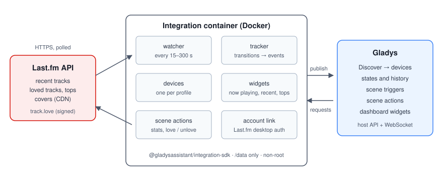
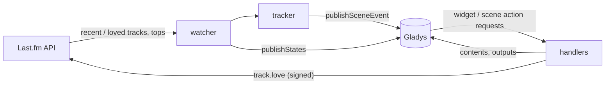
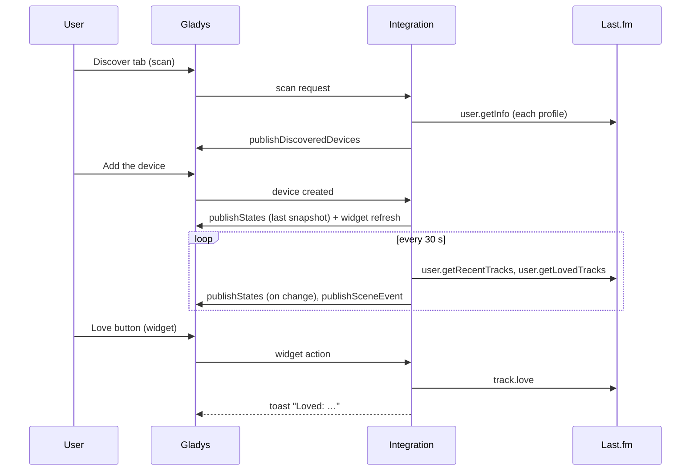
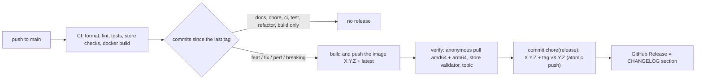

# Gladys Last.fm

**English** · [Français](README.fr.md) · [Deutsch](README.de.md) · [Español](README.es.md)

[](LICENSE)
[](https://github.com/William-De71/gladys-lastfm/releases)
[](https://github.com/William-De71/gladys-lastfm/actions/workflows/release.yml)
[](https://gladysassistant.com)


External [Gladys Assistant](https://gladysassistant.com) integration for **Last.fm**: what you are listening to,
your scrobbles, music-driven **scenes** and **dashboard widgets**, built on `@gladysassistant/integration-sdk` 0.15.

Last.fm records the tracks played on Spotify, Deezer, Apple Music, YouTube Music, Plex, Sonos and many more: one
integration covers every player that scrobbles.


User documentation: [English](docs/en.md) · [Français](docs/fr.md) · [Deutsch](docs/de.md) · [Español](docs/es.md).

> Community integration, not affiliated with or endorsed by Last.fm.

## Contents

- [Features](#features)
- [Architecture](#architecture)
- [Installation](#installation)
- [Configuration](#configuration)
- [How it works](#how-it-works)
- [Development](#development)
- [Release and commit convention](#release-and-commit-convention)
- [Troubleshooting](#troubleshooting)
- [Contributing](#contributing)
- [License](#license)

## Features

### Devices

A device per followed profile (up to 10), offered on the Discover tab, all features read-only:

| Feature                     | Category / type                                 | Notes                                              |
| --------------------------- | ----------------------------------------------- | -------------------------------------------------- |
| Listening                   | `music` / `playback_state`                      | 1 while a track is playing                         |
| Current or last track       | `text` / `text`                                 | "Artist – Track", never emptied                    |
| Scrobbles today             | `counter-sensor` / `integer`                    | since midnight in the Gladys time zone (`TZ`)      |
| Total scrobbles             | `counter-sensor` / `integer`                    | unknown counters are omitted, never published as 0 |
| Title, Artist, Album, Cover | `music` / `title`, `artist`, `album`, `artwork` | Gladys 5.3 now playing, empty when nothing plays   |

The `music` features (since Gladys 5.3, `"music": {}`) come through `publishNowPlaying`, on changes only; the cover is served behind a key by the SDK. No duration nor position (Last.fm gives neither), and no music box on the dashboard: a profile is not a player that obeys play / pause. A device created before gets them with the **Update** button of the Discover tab.

External ids: `ext:<selector>:user:<lowercased username>[:<feature>]`.

### Scene triggers

| Trigger             | Fires when…                                                      | Filters                               |
| ------------------- | ---------------------------------------------------------------- | ------------------------------------- |
| `track_started`     | a track that was not playing a reading ago is                    | profile (`source: "devices"`), artist |
| `listening_started` | something plays after nothing                                    | profile                               |
| `listening_stopped` | nothing played for two readings in a row (session length, count) | profile                               |
| `track_loved`       | a track appears on top of the loved tracks                       | profile, artist                       |

The first reading after a start is a baseline (a session in progress does not replay). One `track_started` per
track change: the same track twice in a row is one event.

Example: **Listening started** (profile "rj") → dim the living room and power the amplifier on; **Listening
stopped** → power it off and send `{{triggerEvent.data.summary}}` ("rj stopped listening after 42 min (11
tracks).").

### Scene actions

`get_now_playing`, `get_stats` (today / total, top artist, album and track over a period), `love_track` and
`unlove_track` (linked account; empty fields = the current or last track).

Example: every evening at 22:00 → **Last.fm: listening statistics** → send a message with its `summary` output.

### Dashboard widgets

| Widget          | Content                                                                                     |
| --------------- | ------------------------------------------------------------------------------------------- |
| `now_playing`   | cover, title, artist · album, today / total tiles, status, Love/Unlove button, Last.fm link |
| `recent_tracks` | card list (1–8) with covers, dates, "now" and "♥" badges                                    |
| `top_charts`    | top artists / albums (cover grid, up to 12) / tracks over 7 days to all time                |

`now_playing` and `recent_tracks` are nudged (`requestWidgetRefresh`) on every change seen by the watcher, and
when a device is added.

Cover images: the widget image key encodes the Last.fm image hash (`lf-<hash>-<ext>`), the handler rebuilds the
`lastfm.freetls.fastly.net` URL from validated pieces only (no SSRF, works after a restart), checks the magic
numbers and the 300 KB bound. The grey star placeholder Last.fm returns for every artist since 2019 is treated as
"no image"; GIF covers are skipped (the core does not serve them).

### Languages

English, French, German and Spanish: manifest, runtime messages, widgets, scene summaries and user docs. Gladys
gives the language to the widgets only; device names and scene texts use the **Language of the texts** setting
(`auto` = the language of the last widget request).

## Architecture





From the Discover tab to a state, and the Love button:



The integration is cloud-only (`transports: ["cloud"]`): it talks to the Last.fm web API and nothing on the local
network.

## Installation

From Gladys: **Integrations → store → Last.fm → Install**. Then follow the [user documentation](docs/en.md): API
key, profiles, Discover tab, optional account link.

Docker image: `ghcr.io/william-de71/gladys-lastfm`, multi-arch (amd64/arm64), non-root, read-only rootfs, OCI
labels and the manifest as the `io.gladysassistant.manifest` label.

## Configuration

| Key             | Type           | Notes                                                         |
| --------------- | -------------- | ------------------------------------------------------------- |
| `api_key`       | `secret`       | required, 32 hex characters                                   |
| `shared_secret` | `secret`       | only for signed calls (account link, love/unlove)             |
| `usernames`     | `string`       | comma separated, validated against the Last.fm username rules |
| `poll_interval` | `number`       | 15–300 s, default 30                                          |
| `language`      | `select`       | `auto` (default), `en`, `fr`, `de`, `es`                      |
| `account`       | `account_link` | Last.fm desktop authentication                                |

Internal keys (outside the schema): `session_key`, `session_user`, `last_language`.

Manifest actions: `test_connection`, `unlink_account`.

### Account link

The Last.fm desktop flow maps onto the `account_link` field (a provider that never redirects back):
`auth.getToken` (signed) → the browser opens `https://www.last.fm/api/auth/?api_key=…&token=…` → the integration
polls `auth.getSession` every 3 s (error 14 until approval) for up to 15 minutes, stores the session key (it does
not expire until revoked) and reports it through `setConnectionStatus`. A revoked session (error 9) is cleared on
the next love attempt.

## How it works

Last.fm has no push API. A watcher reads every profile in turn (default every 30 s): `user.getRecentTracks`
(limit 10, extended — current track, loved flags, total), `user.getRecentTracks` from local midnight (today's
count) and `user.getLovedTracks` (limit 5). Three calls per profile per round: 0.3 request/s for three profiles,
far below the Last.fm limit. Widgets and scene actions reuse the last snapshot while it is under 20 s old. The
devices are published with `should_poll: false`: the watcher is the only timer, and states are published only
when they change.

Errors: Last.fm answers `{ error, message }` with a 200 or a 4xx; codes 8, 11, 16, 29, a 5xx and network failures
are retried once. Invalid / suspended keys and bad signatures switch the connection status to disconnected with an
explicit message; a private profile (17) or an unknown one (6) is explained in the widgets.

## Development

```bash
npm install
npm run format:check
npm run lint
npm test
npx github:GladysAssistant/integration-store . --skip-image-check
docker build -t gladys-lastfm .
```

Node 22 or later. The tests (`node --test`) never touch the network. Beyond the unit tests:

- `test/structure.test.js` compares the device external ids, the feature fields the Discover tab compares and
  every key of the manifest with `test/fixtures/discovery.baseline.json` (version 1.0.0): existing users never
  have to recreate a device;
- `test/i18n.test.js` checks the four languages (manifest, runtime texts, docs, READMEs) and validates the widget
  contents in each;
- `test/release.test.js` covers the release script (version, changelog, bump).

`gladys_version` is `>=5.3.0` (widgets, scene triggers and actions, `account_link`, `source: "devices"`; the music now playing and the catalog keywords of Gladys 5.3).

## Release and commit convention

Releases are automatic. Every push to `main` runs the Release workflow:



- Commits and PR titles follow [Conventional Commits](https://www.conventionalcommits.org/), in English, written
  for the user: they become the changelog lines. `feat` → minor, `fix` / `perf` → patch, `!` or `BREAKING
CHANGE:` → major.
- `CHANGELOG.md` is generated at the release: never edit it by hand.
- The image is published and checked **before** the manifest on `main` announces the new version.
- Manual run (Actions → Release → Run workflow): `release-as` forces a version, `dry-run` only shows the version
  and the notes.
- A protected `main` would reject the release commit: allow GitHub Actions to bypass the rule, or use a GitHub
  App token.

## Troubleshooting

| Symptom                              | Likely cause                                                                     |
| ------------------------------------ | -------------------------------------------------------------------------------- |
| "Last.fm refuses the API key"        | key miscopied, or a wrong shared secret when linking                             |
| A profile is missing from Discover   | the username does not exist (see the integration logs)                           |
| "hides their recent listening"       | the profile enabled the matching privacy option on Last.fm                       |
| Nothing happens while listening      | the player does not scrobble: check that the track shows on your Last.fm profile |
| Device names or summaries in English | set **Language of the texts**, or open a Last.fm widget once                     |

Detailed logs: set the environment variable `DEBUG=gladys-integration-sdk` on the container.

## Contributing

Issues and pull requests are welcome: bug reports with the Gladys version, the integration version and the logs
([issue templates](.github/ISSUE_TEMPLATE)). Feedback on the
[Gladys forum thread](https://community.gladysassistant.com/t/integration-externe-last-fm-vos-ecoutes-musicales-dans-gladys/11035)
too. Security problems: see [SECURITY.md](SECURITY.md).

## License

[Apache-2.0](LICENSE) — see [NOTICE](NOTICE).
